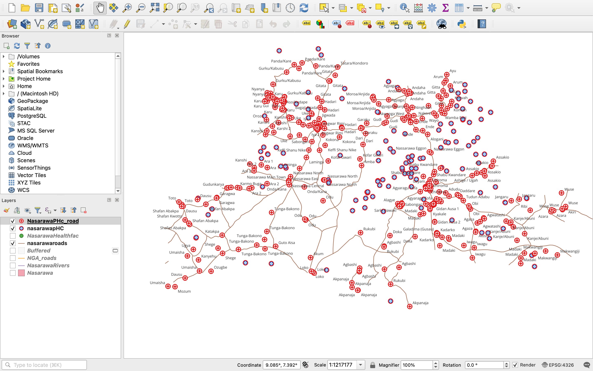

# 🗺️ nasarawa-health-proximity-analysis

> A QGIS proximity analysis using GRID3 spatial data to optimize primary healthcare facility infrastructure and funding allocations across Nasarawa State, Nigeria.

[](https://github.com/chiemeriechibuzor/Gis-healthcare-infrastructure-optimization/blob/2b7509e5706473a0c0d8c935021995385a78521f/HealthFacNasarawa.qgz)
[](LICENSE)


# 🗺️ nasarawa-health-proximity-analysis

> 🚀 QGIS proximity analysis using GRID3 spatial data to identify and optimize primary healthcare facilities within a 5km transit corridor for infrastructure funding in Nasarawa State, Nigeria.

---

## 🚀 1. Project Executive Summary
* **What:** An end-to-end GIS spatial analysis that identifies public health facilities in Nasarawa State, Nigeria, located within close proximity to major road networks to assist the government in infrastructure optimization.
* **Why:** Proximity to transportation infrastructure is crucial for logistics, supply chain management (vaccines/medicine), and emergency accessibility. Facilities near major roads are prime candidates for targeted renovations and strategic funding due to their high service potential.
* **Impact:** This analysis transforms raw spatial data into an actionable governance tool, allowing public health administrators to move away from arbitrary resource allocation and adopt a **data-driven investment strategy** that maximizes the social return on investment (ROI).

---

## 🎯 2. Problem Statement & Project Objectives
### Problem Statement
In developing regions, public health spending is frequently constrained. Without spatial insights, funding for facility renovations is often allocated based on anecdotal evidence or political bias, leading to inefficient use of public capital. Health centers that are highly accessible via road networks must be prioritized for development to serve as regional medical hubs. Conversely, isolated facilities require different infrastructural interventions.

### Quantitative Objectives
1. **Delineate the Study Area:** Isolate spatial data exclusively for Nasarawa State from a national data repository.
2. **Standardize the Coordinate System:** Project all data layers into a local, meter-based Coordinate Reference System (CRS) for accurate distance measurements.
3. **Filter Health Infrastructure:** Extract only "Primary Health Care Centers" from a mixed-facility dataset using attribute queries.
4. **Conduct Proximity Modeling:** Generate a strict **5-kilometer buffer** zone around the primary road infrastructure and isolate the health facilities falling within this access corridor.

---

## 🛠️ 3. Tech Stack & Data Architecture
### Software and GIS Tools
* **GIS Platform:** QGIS (Quantum GIS) Desktop
* **Core Toolsets used:** Vector Geoprocessing (Clip, Buffer), Data Selection (Select by Attribute, Select by Location), Cartographic Design (Layer Styling & Labeling).

### Spatial Data Inventory (ETL Pipeline)
The raw datasets were acquired from **GRID3 (Geo-Referenced Infrastructure and Demographic Data for Development)**, an authoritative repository for sub-Saharan African spatial data.

| Layer Name | Geometry Type | Data Source | Original CRS | Projected CRS (Used) | Purpose |
| :--- | :--- | :--- | :--- | :--- | :--- |
| **NGA_Administrative_Boundaries** | Polygon (Vector) | GRID3 | EPSG:4326 (WGS 84) | EPSG:32632 (WGS 84 / UTM Zone 32N) | Used to crop and scope the analysis to Nasarawa State. |
| **NGA_Road_Network** | Line (Vector) | GRID3 | EPSG:4326 (WGS 84) | EPSG:32632 (WGS 84 / UTM Zone 32N) | Baseline infrastructure used for proximity buffer. |
| **NGA_Health_Facilities** | Point (Vector) | GRID3 | EPSG:4326 (WGS 84) | EPSG:32632 (WGS 84 / UTM Zone 32N) | Target assets containing attribute data for facility types. |
| **NGA_Waterways_Rivers** | Line (Vector) | GRID3 | EPSG:4326 (WGS 84) | EPSG:32632 (WGS 84 / UTM Zone 32N) | Secondary infrastructure layer for environmental context. |

---

## ⚙️ 4. Spatial Analysis Workflow (Methodology)

### Phase 1: Data Ingestion and Spatial Scoping (ETL)
* **Layer Initialization:** Loaded the nationwide shapefiles into the Map Canvas.
* **Administrative Scoping:** Selected Nasarawa State from the national administrative layer. To ensure strict data integrity and mathematical accuracy for distance calculations, all layers were projected from geographic coordinates (degrees) to the **WGS 84 / UTM Zone 32N (EPSG:32632)** projected coordinate system, which is the specialized zone for North-Central Nigeria.

### Phase 2: Vector Geoprocessing (Clipping)
* **Operation:** Executed a **Vector Clip** operation using the specialized Nasarawa boundary polygon as the mask layer.
* **Result:** Trimmed the massive national road and health facility networks into localized, high-performance layers dedicated exclusively to Nasarawa State, eliminating irrelevant data memory footprints.

[National Dataset] ──> (Clip Mask: Nasarawa Boundary) ──> [Localized Nasarawa Subsets]

### Phase 3: Attribute Selection (SQL Querying)
* **Operation:** Opened the attribute table of the clipped health facilities layer.
* **Logic:** Formulated a structured query language (SQL) expression to isolate target assets:
  \[\sigma_{\text{facility} = \text{'Primary Healthcare Facility'}}(\text{Health\_Facilities})\]
* **Execution:** Used the expression tool where `amenity = 'primary_healthcare'` (or corresponding column value) to isolate primary health centers from general hospitals and specialized clinics.

### Phase 4: Proximity Analysis & Spatial Join (Select by Location)
* **Buffer Generation & Proximity Selection:** Rather than creating a permanent heavy vector file for the buffer, a programmatic approach was taken using **Select by Location**.
* **Spatial Relationship:** Selected features from the extracted *Primary Health Centers* layer that intersect or lie within a strict **5,000-meter (5km)** maximum distance parameter of the *Nasarawa Road Network* line features.
* **Layer Integration:** Isolated these high-accessibility target assets into a distinct operational layer for visualization.

---

## 📈 5. Key Insights & Data Visualization
The resulting cartographic products provided high-contrast visibility into Nasarawa's healthcare landscape:

### Spatially Isolated Access Corridors
The analysis successfully isolated specific electoral and administrative wards where primary health infrastructure sits directly within the 5km high-access transit corridor. 

### Dynamic Labeling & Cartographic Presentation
* **Label Formatting:** Leveraged the layer property configuration engine to turn on vector labeling. 
* **Placement Engine:** Configured dynamic labels using the administrative Ward names associated with each target health center point. This ensures instant readability for policymakers review teams without needing to query back-end attribute tables manually.

```markdown

*Figure 1: Final cartographic output showcasing Primary Healthcare Facilities within a 5km buffer zone of primary transit infrastructure in Nasarawa State, dynamically labeled by Administrative Ward.*
```

---

## 🌍 6. Governance and Socio-Economic Impact

This analysis moves the needle from speculative asset management to targeted public resource maximization:

* **Optimized Capital Expenditure (CapEx):** By funding the renovation of health centers close to roads, policymakers can guarantee that construction equipment, materials, and medical supplies can reach the site easily, drastically lowering project costs.
* **Maximizing Patient Footprint:** Health centers within 5km of major roads handle a larger volume of regional commuter traffic. Investing here yields a much higher public health utility rate compared to investing in inaccessible zones.
* **Emergency Response Readiness:** This mapped corridor acts as a layout plan for distributing medical supplies, deploying ambulances, and setting up centralized emergency response services.

---

## 🚀 7. How to Reproduce This Analysis

### Prerequisites
* QGIS Desktop 3.x installed.
* Access to internet connection to clone this repository.

### Step-by-Step Replication Execution
1. **Clone the Repository:**
   ```bash
   git clone https://github.com
   cd nasarawa-health-proximity-analysis
   ```
2. **Load the Project:** Open QGIS, select `Project` -> `Open`, and open the `Nasarawa_Health_Analysis.qgz` file.
3. **Data Verification:** Ensure all source data pathways map correctly to the shapefiles stored inside the `/data` directory.
4. **Running the Pipeline manually:**
   * Run the expression query on the health facility layer attribute table.
   * Navigate to `Vector` -> `Research Tools` -> `Select by Location`.
   * Set Geometric Predictate to `are within` and include a distance of `5000 meters` from the road alignment layer.

---
## 📄 License
This project is licensed under the MIT License - see the [LICENSE](LICENSE) file for details.
---
